# Matplotex

A comprehensive charting library for Elixir. All coordinate math runs through [Nx](https://github.com/elixir-nx/nx) tensor operations. Charts compile to SVG strings.

## Gallery

| | | |
|:---:|:---:|:---:|
| 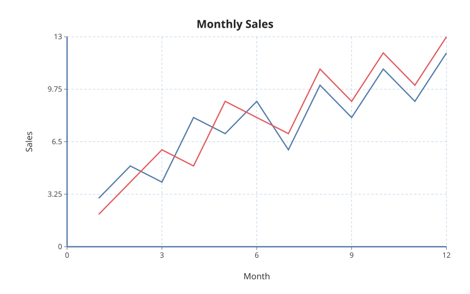 | 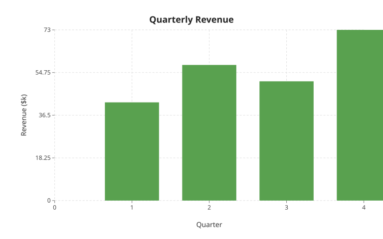 | 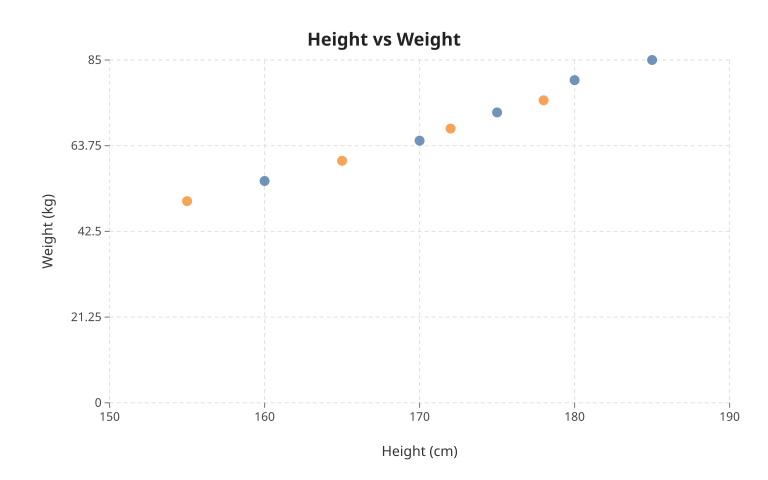 |
| Line | Bar | Scatter |
| 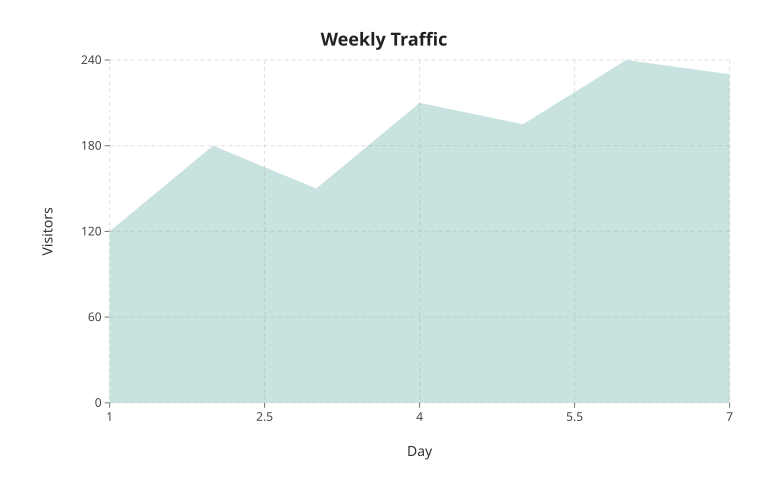 | 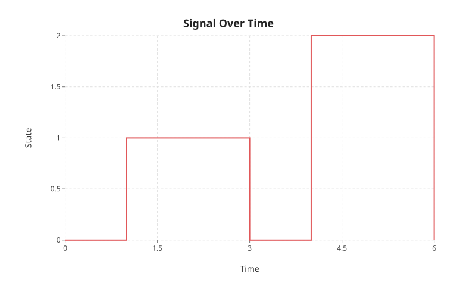 | 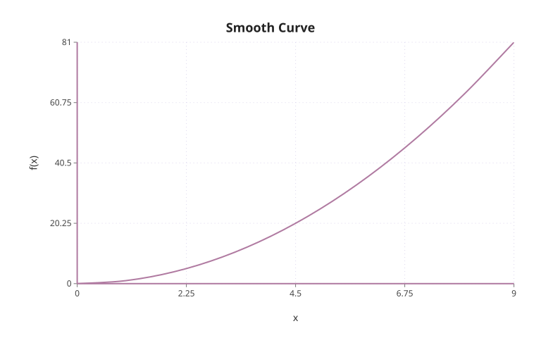 |
| Area | Step | Spline |
| 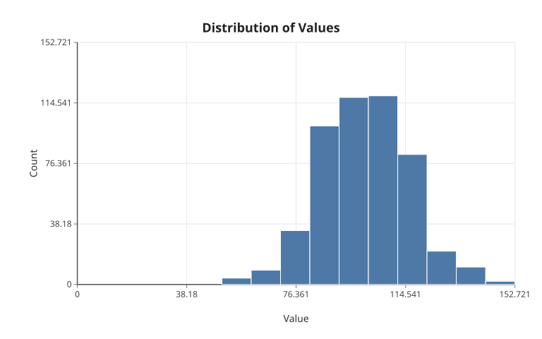 | 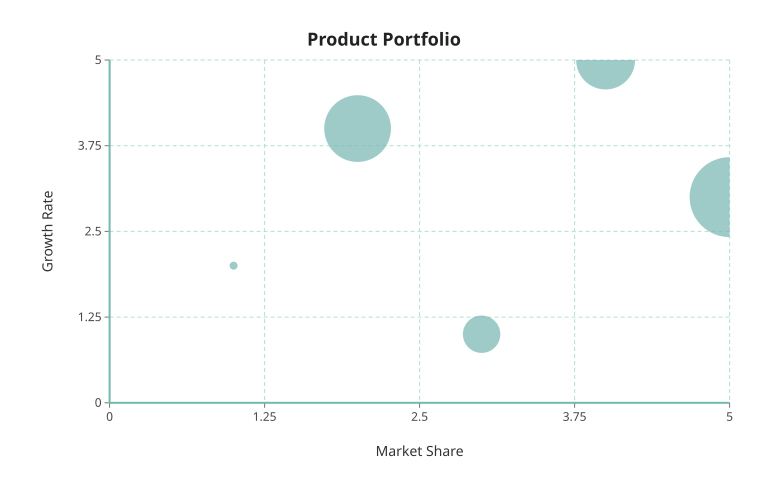 | 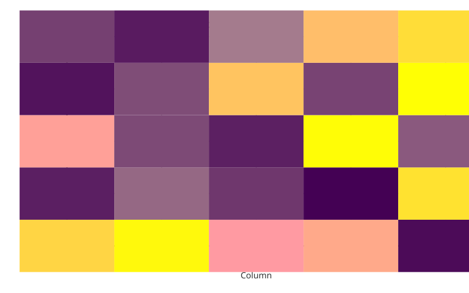 |
| Histogram | Bubble | Heatmap |
| 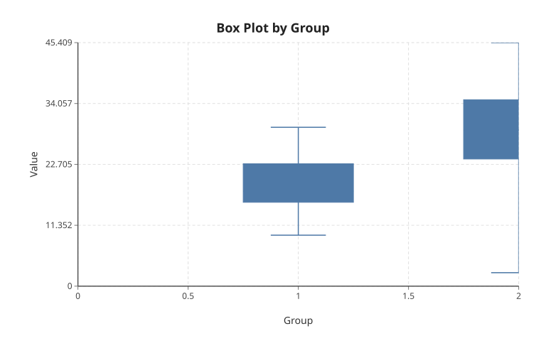 | 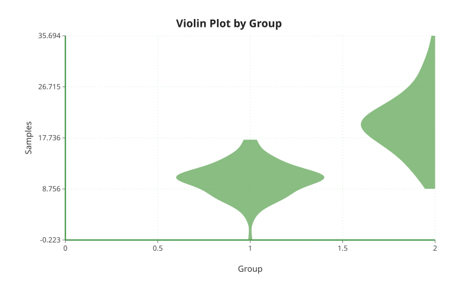 | 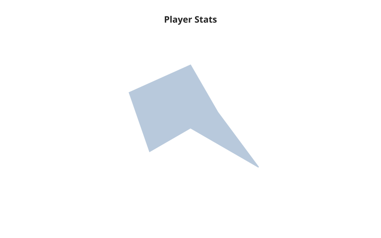 |
| Box Plot | Violin | Radar |
| 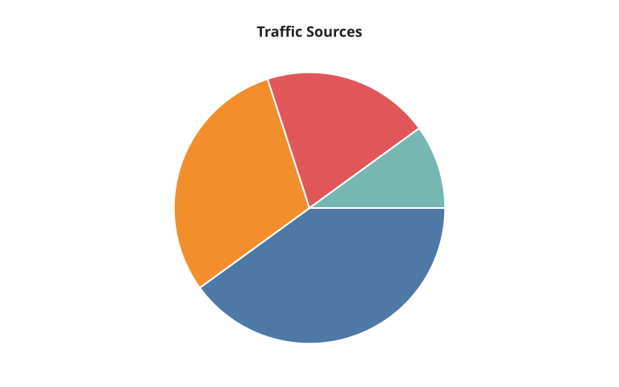 | 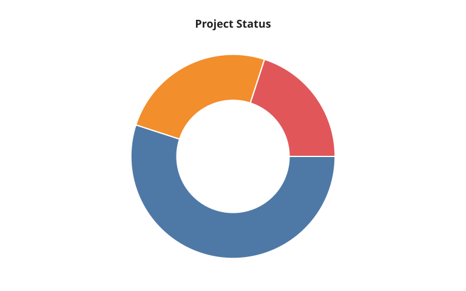 | 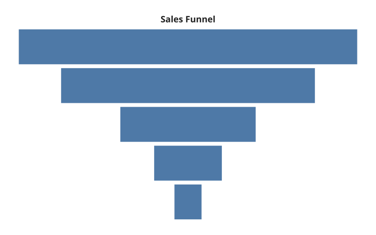 |
| Pie | Donut | Funnel |
| 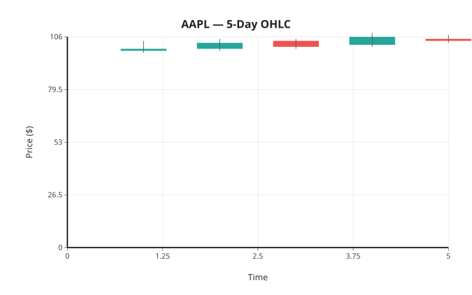 | 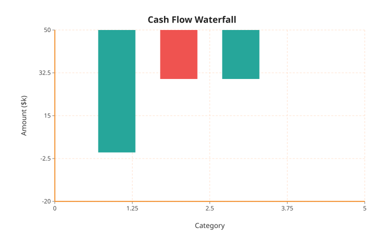 | |
| Candlestick | Waterfall | |

---

## Installation

Add `matplotex` to your dependencies in `mix.exs`:

```elixir
def deps do
  [
    {:matplotex, "~> 0.1.0"}
  ]
end
```

## Quick Start

```elixir
alias Matplotex.{Chart, Axis, Dataset}
alias Matplotex.Render.SVG

Chart.new(:line)
|> Chart.put_axis(:x1, %Axis{dimension: :x, position: :bottom, label: "Month"})
|> Chart.put_axis(:y1, %Axis{dimension: :y, position: :left,   label: "Revenue"})
|> Chart.add_data(Enum.zip(1..12, [3,5,4,8,7,9,6,10,8,11,9,12]), name: "2024")
|> Chart.set_title("Monthly Revenue")
|> Chart.compile()
|> SVG.to_svg()
# => "<svg>...</svg>"
```

## Core Concepts

### Building a Chart

Every chart follows the same pipeline:

```
Chart.new/2  →  put_axis/3  →  put_dataset/2  →  compile/1  →  SVG.to_svg/1
```

All builder functions return an updated chart struct — the API is fully immutable and pipe-friendly.

### Adding Data

**From `{x, y}` pairs** — the simplest way:

```elixir
Chart.add_data(chart, [{1, 10}, {2, 20}, {3, 15}], name: "Series A", color: "#4e79a7")
```

**From columns** — when you have separate lists or need `z` values:

```elixir
ds = Dataset.from_columns(
  x: [1.0, 2.0, 3.0],
  y: [10.0, 20.0, 15.0],
  z: [5.0, 8.0, 12.0],   # optional third dimension (size, intensity, etc.)
  labels: ["A", "B", "C"],
  name: "Series",
  color: "#4e79a7"
)

Chart.put_dataset(chart, ds)
```

### Axes

```elixir
%Axis{
  dimension:   :x | :y | :z,                    # which data column maps to this axis
  position:    :bottom | :top | :left | :right,  # where the axis is drawn
  label:       "Axis label",                     # optional title
  tick_count:  5,                                # approximate number of ticks
  tick_format: &Float.to_string/1               # optional custom formatter
}
```

### Canvas

Control physical size, fonts, and grid color:

```elixir
canvas = %Matplotex.Canvas{
  figsize:         {10, 6},   # width × height in inches
  dpi:             96,
  margin:          0.05,      # fraction of canvas on each side
  title_font_size: 18,
  tick_font_size:  12,
  label_font_size: 14,
  grid_color:      "#e0e0e0"
}

Chart.new(:line, canvas: canvas)
```

### Axis Limits (xmin / xmax / ymin / ymax)

By default, axis domains are inferred from the data. Use `set_axis_limits/4` to pin them explicitly — useful for zooming into a region, keeping consistent scales across charts, or padding beyond the data range.

```elixir
Chart.new(:line)
|> Chart.put_axis(:x1, %Axis{dimension: :x, position: :bottom, label: "Month"})
|> Chart.put_axis(:y1, %Axis{dimension: :y, position: :left,   label: "Revenue"})
|> Chart.add_data(Enum.zip(1..12, [3,5,4,8,7,9,6,10,8,11,9,12]), name: "2024")
|> Chart.set_axis_limits(:x1, 0.0, 15.0)   # x from 0 to 15 regardless of data
|> Chart.set_axis_limits(:y1, 0.0, 20.0)   # y from 0 to 20 regardless of data
|> Chart.compile()
|> SVG.to_svg()
```

- Limits apply per axis — you can fix one axis while leaving the other auto-scaled.
- Tick labels and tick pixel positions are computed from the explicit limits.
- The guard `min < max` is enforced at call time; swapped values raise `FunctionClauseError`.

### Viewport (Zoom & Pan)

```elixir
Chart.set_viewport(chart, %Matplotex.Viewport{
  zoom_x: 1.5,   # horizontal zoom factor
  zoom_y: 1.0,
  pan_x:  0.1,   # normalized offset
  pan_y:  0.0
})
```

---

## Chart Types

### Line

Continuous path connecting `{x, y}` points. Points are auto-sorted by x. Supports multiple series.


```elixir
alias Matplotex.{Chart, Axis}
alias Matplotex.Render.SVG

svg =
  Chart.new(:line)
  |> Chart.put_axis(:x1, %Axis{dimension: :x, position: :bottom, label: "Month"})
  |> Chart.put_axis(:y1, %Axis{dimension: :y, position: :left,   label: "Sales"})
  |> Chart.add_data(Enum.zip(1..12, [3,5,4,8,7,9,6,10,8,11,9,12]),
       name: "2023", color: "#4e79a7")
  |> Chart.add_data(Enum.zip(1..12, [2,4,6,5,9,8,7,11,9,12,10,13]),
       name: "2024", color: "#e15759")
  |> Chart.set_title("Monthly Sales")
  |> Chart.compile()
  |> SVG.to_svg()
```

---

### Bar

Vertical bars from a baseline of `y=0`. x values are treated as category indices.


```elixir
svg =
  Chart.new(:bar)
  |> Chart.put_axis(:x1, %Axis{dimension: :x, position: :bottom, label: "Quarter"})
  |> Chart.put_axis(:y1, %Axis{dimension: :y, position: :left,   label: "Revenue ($k)"})
  |> Chart.add_data([{1, 42}, {2, 58}, {3, 51}, {4, 73}], name: "Revenue", color: "#59a14f")
  |> Chart.set_title("Quarterly Revenue")
  |> Chart.set_axis_limits(:x1, 0.5, 4.5)
  |> Chart.compile()
  |> SVG.to_svg()
```

---

### Scatter

One circle per `{x, y}` point. Use `color` per dataset to distinguish groups.


```elixir
svg =
  Chart.new(:scatter)
  |> Chart.put_axis(:x1, %Axis{dimension: :x, position: :bottom, label: "Height (cm)"})
  |> Chart.put_axis(:y1, %Axis{dimension: :y, position: :left,   label: "Weight (kg)"})
  |> Chart.add_data(
       [{160, 55}, {170, 65}, {175, 72}, {180, 80}, {185, 85}],
       name: "Group A", color: "#4e79a7")
  |> Chart.add_data(
       [{155, 50}, {165, 60}, {172, 68}, {178, 75}],
       name: "Group B", color: "#f28e2b")
  |> Chart.set_title("Height vs Weight")
  |> Chart.set_axis_limits(:x1, 150.0, 190.0)
  |> Chart.compile()
  |> SVG.to_svg()
```

---

### Area

Filled region between a baseline and the `y` values. Ideal for showing volume over time.


```elixir
svg =
  Chart.new(:area)
  |> Chart.put_axis(:x1, %Axis{dimension: :x, position: :bottom, label: "Day"})
  |> Chart.put_axis(:y1, %Axis{dimension: :y, position: :left,   label: "Visitors"})
  |> Chart.add_data(
       Enum.zip(1..7, [120, 180, 150, 210, 195, 240, 230]),
       name: "Unique Visitors", color: "#76b7b2")
  |> Chart.set_title("Weekly Traffic")
  |> Chart.set_axis_limits(:x1, 1.0, 7.0)
  |> Chart.compile()
  |> SVG.to_svg()
```

---

### Step

Staircase line — horizontal segment first, then vertical. Good for discrete state changes.


```elixir
svg =
  Chart.new(:step)
  |> Chart.put_axis(:x1, %Axis{dimension: :x, position: :bottom, label: "Time"})
  |> Chart.put_axis(:y1, %Axis{dimension: :y, position: :left,   label: "State"})
  |> Chart.add_data(
       [{0, 0}, {1, 1}, {2, 1}, {3, 0}, {4, 2}, {5, 2}, {6, 0}],
       name: "Signal", color: "#e15759")
  |> Chart.set_title("Signal Over Time")
  |> Chart.compile()
  |> SVG.to_svg()
```

---

### Spline

Smooth Catmull-Rom curve through `{x, y}` points. Same API as line.


```elixir
svg =
  Chart.new(:spline)
  |> Chart.put_axis(:x1, %Axis{dimension: :x, position: :bottom, label: "x"})
  |> Chart.put_axis(:y1, %Axis{dimension: :y, position: :left,   label: "f(x)"})
  |> Chart.add_data(
       Enum.zip(0..9, [0, 1, 4, 9, 16, 25, 36, 49, 64, 81]),
       name: "x²", color: "#b07aa1")
  |> Chart.set_title("Smooth Curve")
  |> Chart.compile()
  |> SVG.to_svg()
```

---

### Histogram

Auto-bins a list of samples using Sturges' rule. Pass raw values to `x` (the `y` column is computed).


```elixir
alias Matplotex.Dataset

samples = for _ <- 1..2000, do: :rand.normal() * 15 + 100

svg =
  Chart.new(:histogram)
  |> Chart.put_axis(:x1, %Axis{dimension: :x, position: :bottom, label: "Value"})
  |> Chart.put_axis(:y1, %Axis{dimension: :y, position: :left,   label: "Count"})
  |> Chart.put_dataset(Dataset.from_columns(x: samples, y: samples, color: "#4e79a7"))
  |> Chart.set_title("Distribution of Values")
  |> Chart.compile()
  |> SVG.to_svg()
```

---

### Scatter with Bubble (Bubble Chart)

Like scatter, but the `z` column controls each point's radius. Area is proportional to `z`.


```elixir
ds = Dataset.from_columns(
  x:     [1, 2, 3, 4, 5],
  y:     [2, 4, 1, 5, 3],
  z:     [10, 30, 15, 25, 40],  # bubble sizes
  name:  "Products",
  color: "#76b7b2"
)

svg =
  Chart.new(:bubble)
  |> Chart.put_axis(:x1, %Axis{dimension: :x, position: :bottom, label: "Market Share"})
  |> Chart.put_axis(:y1, %Axis{dimension: :y, position: :left,   label: "Growth Rate"})
  |> Chart.put_dataset(ds)
  |> Chart.set_title("Product Portfolio")
  |> Chart.compile()
  |> SVG.to_svg()
```

---

### Pie

Circular slices sized by `y` values. Pass slice names in `labels`.


```elixir
ds = Dataset.from_columns(
  y:      [40, 30, 20, 10],
  labels: ["Organic", "Paid", "Social", "Direct"]
)

svg =
  Chart.new(:pie)
  |> Chart.put_dataset(ds)
  |> Chart.set_title("Traffic Sources")
  |> Chart.compile()
  |> SVG.to_svg()
```

---

### Donut

Same as pie with a hollow centre. Useful when you want to annotate the centre.


```elixir
ds = Dataset.from_columns(
  y:      [55, 25, 20],
  labels: ["Complete", "In Progress", "Not Started"]
)

svg =
  Chart.new(:donut)
  |> Chart.put_dataset(ds)
  |> Chart.set_title("Project Status")
  |> Chart.compile()
  |> SVG.to_svg()
```

---

### Heatmap

Colored grid where `x` = column index, `y` = row index, `z` = intensity. Colors use the viridis scale.


```elixir
# Build a 5×5 grid
{xs, ys, zs} =
  for row <- 0..4, col <- 0..4 do
    {col * 1.0, row * 1.0, :rand.uniform() * 100}
  end
  |> Enum.unzip3()

# Enum.unzip3 doesn't exist — use reduce instead
{xs, ys, zs} =
  for(row <- 0..4, col <- 0..4, do: {col * 1.0, row * 1.0, :rand.uniform() * 100})
  |> Enum.reduce({[], [], []}, fn {x, y, z}, {xs, ys, zs} ->
    {xs ++ [x], ys ++ [y], zs ++ [z]}
  end)

ds = Dataset.from_columns(x: xs, y: ys, z: zs)

svg =
  Chart.new(:heatmap)
  |> Chart.put_axis(:x1, %Axis{dimension: :x, position: :bottom, label: "Column"})
  |> Chart.put_axis(:y1, %Axis{dimension: :y, position: :left,   label: "Row"})
  |> Chart.put_dataset(ds)
  |> Chart.set_title("Heatmap Example")
  |> Chart.compile()
  |> SVG.to_svg()
```

---

### Box Plot

Five-number summary (min, Q1, median, Q3, max) per group. Pass raw samples with their group index.


```elixir
# Group 1 (x=1) and Group 2 (x=2)
group_xs = List.duplicate(1, 50) ++ List.duplicate(2, 50)
group_ys =
  Enum.map(1..50, fn _ -> :rand.normal() * 5 + 20 end) ++
  Enum.map(1..50, fn _ -> :rand.normal() * 8 + 30 end)

ds = Dataset.from_columns(x: group_xs, y: group_ys)

svg =
  Chart.new(:box)
  |> Chart.put_axis(:x1, %Axis{dimension: :x, position: :bottom, label: "Group"})
  |> Chart.put_axis(:y1, %Axis{dimension: :y, position: :left,   label: "Value"})
  |> Chart.put_dataset(ds)
  |> Chart.set_title("Box Plot by Group")
  |> Chart.compile()
  |> SVG.to_svg()
```

---

### Violin

Mirrored KDE density per group. Same data format as box plot.


```elixir
group_xs = List.duplicate(1, 100) ++ List.duplicate(2, 100)
group_ys =
  Enum.map(1..100, fn _ -> :rand.normal() * 3 + 10 end) ++
  Enum.map(1..100, fn _ -> :rand.normal() * 6 + 20 end)

ds = Dataset.from_columns(x: group_xs, y: group_ys, color: "#59a14f")

svg =
  Chart.new(:violin)
  |> Chart.put_axis(:x1, %Axis{dimension: :x, position: :bottom, label: "Group"})
  |> Chart.put_axis(:y1, %Axis{dimension: :y, position: :left,   label: "Samples"})
  |> Chart.put_dataset(ds)
  |> Chart.set_title("Violin Plot by Group")
  |> Chart.compile()
  |> SVG.to_svg()
```

---

### Radar / Spider

N-dimensional data on radial axes. `y` = values, `labels` = axis names. Multiple datasets overlay as polygons.


```elixir
ds = Dataset.from_columns(
  y:      [0.8, 0.6, 0.9, 0.4, 0.7, 0.85],
  labels: ["Speed", "Strength", "Agility", "Defense", "Skill", "Stamina"],
  name:   "Player A",
  color:  "#4e79a7"
)

svg =
  Chart.new(:radar)
  |> Chart.put_dataset(ds)
  |> Chart.set_title("Player Stats")
  |> Chart.compile()
  |> SVG.to_svg()
```

---

### Candlestick

OHLC bars for financial data. `x` = time, `y` = close price. Open, high, and low go in `extra`.


```elixir
times  = [1, 2, 3, 4, 5]
closes = [100.0, 103.0, 101.0, 106.0, 104.0]
opens  = [99.0,  100.0, 104.0, 102.0, 105.0]
highs  = [104.0, 105.0, 105.0, 108.0, 107.0]
lows   = [98.0,   99.0, 100.0, 101.0, 103.0]

ds =
  Dataset.from_columns(x: times, y: closes)
  |> then(fn d ->
    %{d | extra: %{
      open: Nx.tensor(opens, type: :f64),
      high: Nx.tensor(highs, type: :f64),
      low:  Nx.tensor(lows,  type: :f64)
    }}
  end)

svg =
  Chart.new(:candlestick)
  |> Chart.put_axis(:x1, %Axis{dimension: :x, position: :bottom, label: "Time"})
  |> Chart.put_axis(:y1, %Axis{dimension: :y, position: :left,   label: "Price ($)"})
  |> Chart.put_dataset(ds)
  |> Chart.set_title("AAPL — 5-Day OHLC")
  |> Chart.compile()
  |> SVG.to_svg()
```

Bullish candles (close ≥ open) render green; bearish candles render red.

---

### Waterfall

Cumulative bars where each bar starts where the previous ended. Positive increments are green, negative red.


```elixir
svg =
  Chart.new(:waterfall)
  |> Chart.put_axis(:x1, %Axis{dimension: :x, position: :bottom, label: "Category"})
  |> Chart.put_axis(:y1, %Axis{dimension: :y, position: :left,   label: "Amount ($k)"})
  |> Chart.add_data(
       [{1, 50}, {2, -20}, {3, 30}, {4, -10}, {5, 40}],
       name: "Cash Flow")
  |> Chart.set_title("Cash Flow Waterfall")
  |> Chart.compile()
  |> SVG.to_svg()
```

---

### Funnel

Horizontal bars centred on the axis, each narrower than the one above. Pass stage values largest-first in `y`.


```elixir
ds = Dataset.from_columns(
  y:      [1000, 750, 400, 200, 80],
  labels: ["Awareness", "Interest", "Consideration", "Intent", "Purchase"]
)

svg =
  Chart.new(:funnel)
  |> Chart.put_dataset(ds)
  |> Chart.set_title("Sales Funnel")
  |> Chart.compile()
  |> SVG.to_svg()
```

---

## Supported Chart Types

| Atom           | Chart          | Key columns              |
|----------------|----------------|--------------------------|
| `:line`        | Line           | x, y                     |
| `:bar`         | Bar            | x (category), y          |
| `:scatter`     | Scatter        | x, y                     |
| `:area`        | Area           | x, y                     |
| `:step`        | Step           | x, y                     |
| `:spline`      | Spline         | x, y                     |
| `:histogram`   | Histogram      | x (raw samples)          |
| `:bubble`      | Bubble         | x, y, z (size)           |
| `:pie`         | Pie            | y, labels                |
| `:donut`       | Donut          | y, labels                |
| `:heatmap`     | Heatmap        | x (col), y (row), z      |
| `:box`         | Box Plot       | x (group), y (samples)   |
| `:violin`      | Violin         | x (group), y (samples)   |
| `:radar`       | Radar/Spider   | y (values), labels       |
| `:candlestick` | Candlestick    | x, y (close), extra OHLC |
| `:waterfall`   | Waterfall      | x, y (increments)        |
| `:funnel`      | Funnel         | y, labels                |

```elixir
Chart.supported_types()
# => [:line, :bar, :scatter, :area, :histogram, :pie, :donut, :heatmap,
#     :box, :violin, :bubble, :radar, :candlestick, :waterfall, :funnel,
#     :step, :spline]
```

---

## Multiple Series

Most chart types accept multiple datasets. Add them one after another:

```elixir
Chart.new(:line)
|> Chart.add_data(Enum.zip(1..6, [1,3,2,5,4,6]),  name: "Apples",  color: "#e15759")
|> Chart.add_data(Enum.zip(1..6, [2,2,4,3,5,5]),  name: "Oranges", color: "#f28e2b")
|> Chart.add_data(Enum.zip(1..6, [1,2,3,2,4,5]),  name: "Bananas", color: "#edc948")
|> Chart.put_axis(:x1, %Axis{dimension: :x, position: :bottom})
|> Chart.put_axis(:y1, %Axis{dimension: :y, position: :left})
|> Chart.compile()
|> SVG.to_svg()
```

When no `color` is given, each series gets a color from a built-in 10-color palette.

---

## Recompilation & Dirty Tracking

`Chart.compile/1` only recomputes layers that changed. Mutating data reruns scales and geometry; mutating canvas reruns layout, scales, and geometry. This makes incremental updates cheap:

```elixir
compiled = Chart.compile(chart)

# Update data → only scales + geometry recompute
compiled
|> Chart.add_data(new_pairs, name: "New series")
|> Chart.compile()
```

---

## Saving SVG to a File

```elixir
svg_string =
  Chart.new(:bar)
  |> Chart.add_data([{1, 10}, {2, 20}, {3, 15}])
  |> Chart.put_axis(:x1, %Axis{dimension: :x, position: :bottom})
  |> Chart.put_axis(:y1, %Axis{dimension: :y, position: :left})
  |> Chart.compile()
  |> SVG.to_svg()

File.write!("chart.svg", svg_string)
```
